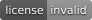

# ESPHome External Components

[](https://esphome.io/components/external_components/)
[](https://github.com/eigger/espcomponents/releases)
[](LICENSE)

Custom ESPHome components and device configurations for Home Assistant — from
RS-485 wallpads and SIP intercoms to vehicle dashboards and BLE sensors.

[Components](#components) · [Device packages](#device-packages) · [Tests](tests/README.md) · [Wallpad guide](https://github.com/eigger/espcomponents/wiki)

## Quick start

Add the components you need to your ESPHome YAML:

```yaml
external_components:
  - source: github://eigger/espcomponents@latest
    components: [uartex]  # Replace with the component(s) you need
```

This loads the component code. Open its documentation below for the required
hardware, wiring, and configuration. For a complete device setup, start with a
[device package](#device-packages).

## Components

| Component | Purpose |
| --- | --- |
| [uartex](components/uartex) | Custom UART / RS-485 protocols and device control |
| [tcp_server](components/tcp_server) | TCP server with UART forwarding examples |
| [sip_client](components/sip_client) | SIP voice calls and intercoms; G.711 and optional G.722 |
| [ws_bridge](components/ws_bridge) | Home Assistant entities over WebSocket; ESP32 / ESP-IDF |
| [ble_elm327](components/ble_elm327) | Vehicle diagnostics and telemetry via BLE OBD-II |
| [jaalee_jht](components/jaalee_jht) | Jaalee JHT BLE temperature and humidity sensors |
| [axp192](components/axp192) | AXP192 power management |
| [bbq10_keyboard](components/bbq10_keyboard) | LilyGO Watch BBQ10 keyboard |
| [lilygo_t_keyboard](components/lilygo_t_keyboard) | LilyGO T-Keyboard |
| [tca8418_keyboard](components/tca8418_keyboard) | TCA8418 keypad controller / M5Cardputer ADV keyboard |
| [m5unit_scales](components/m5unit_scales) | M5Stack Unit Scales and Unit-Mini Scales |

## Device packages

Device-specific YAML configurations, wiring, and setup instructions.

| Use case | Packages |
| --- | --- |
| Wallpads / 월패드 | [Vendor configurations](packages/wallpad) |
| Air conditioners / 에어컨 | [Samsung RS-485](packages/hvac/samsung) |
| Vehicle dashboard | [Colorado / M5Stack Tab5](packages/display/colorado) |
| SIP intercoms | [Voice PE](packages/sip/voice_pe) · [Atom Echo](packages/sip/atom_echo) |
| Presence detection | [Iotorero sensors](packages/presence/iotorero) |
| Buttons | [Neimz](packages/button/neimz) |
| Scales | [M5Stack scale assembly](packages/scale) |
| Lighting | [Puppy LED lamp](packages/led) |
| Radiation monitoring | [Geiger counter](packages/radiation) |

[Browse all packages](packages) for additional configurations.

## Support

[Report a bug](https://github.com/eigger/espcomponents/issues) ·
[Ask a question](https://github.com/eigger/espcomponents/discussions) ·
[MIT License](LICENSE)
