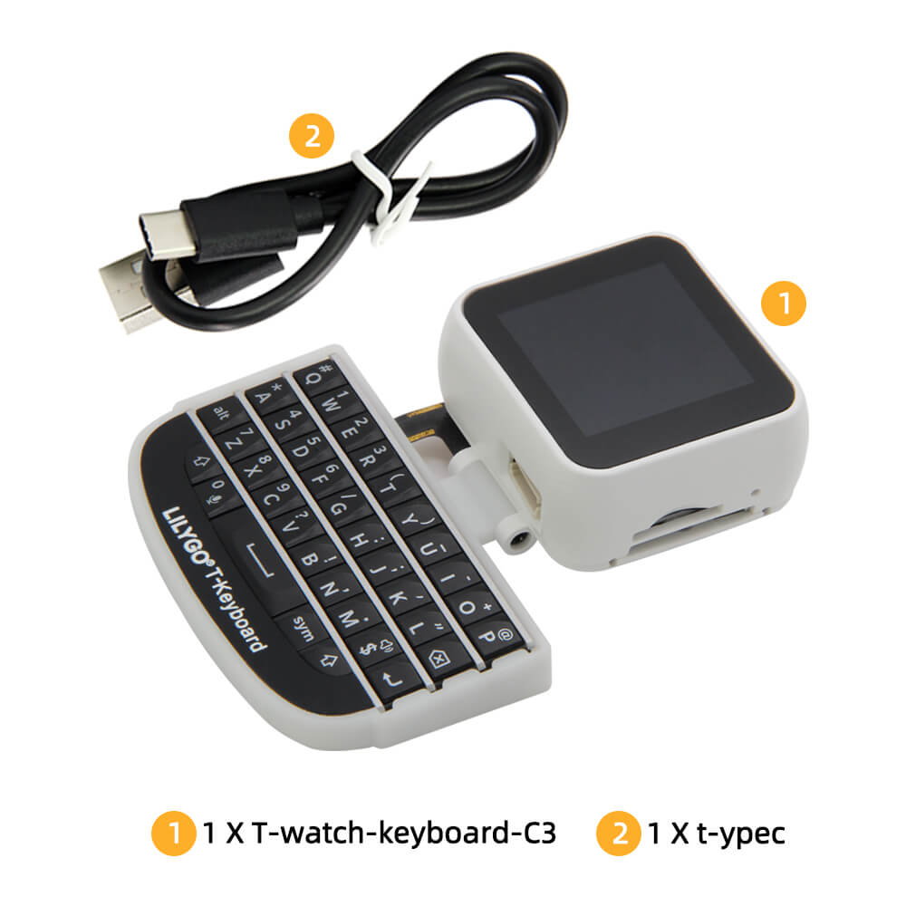

# BBQ10 Keyboard

Reads the LilyGO Watch BBQ10 keyboard over I2C and exposes the current and last
key as text sensors. Requires an I2C bus; the default device address is `0x55`.

## Configuration

Add this to an existing ESPHome device configuration. Adjust SDA/SCL to your board.

```yaml
external_components:
  - source: github://eigger/espcomponents@latest
    components: [bbq10_keyboard]

i2c:
  sda: GPIO21
  scl: GPIO22
  scan: true

bbq10_keyboard:
  address: 0x55
  key:
    name: "Key"
  last_key:
    name: "Last Key"
```

| Option | Behavior |
| --- | --- |
| `key` | Publishes when the key register changes, including release |
| `last_key` | Retains the last nonzero key; useful for displaying the last press |
| `i2c_id` | Selects the bus when multiple I2C buses are configured |

Both text sensors are created by default. Special key values include `Bs`,
`Enter`, and `Alt+c`. If there are no updates, check the I2C scan for `0x55` and
confirm that this is the I2C keyboard, rather than the GPIO T-Keyboard below.



[Other components](../README.md) · [GPIO T-Keyboard](../lilygo_t_keyboard)
