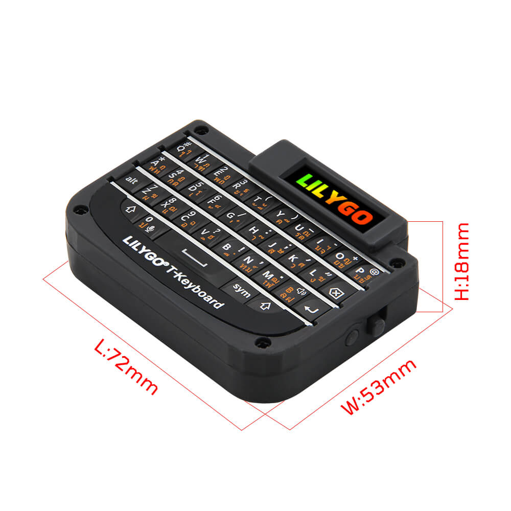

# LilyGO T-Keyboard

Scans the LilyGO T-Keyboard GPIO matrix and publishes key press/release strings.
The implementation uses Arduino GPIO APIs; select the Arduino framework on a
compatible ESP32 board.

## Configuration

Merge this into your device YAML:

```yaml
esp32:
  board: esp32dev  # Replace with your board
  framework:
    type: arduino

external_components:
  - source: github://eigger/espcomponents@latest
    components: [lilygo_t_keyboard]

lilygo_t_keyboard:
  press_key:
    name: "Pressed Key"
  release_key:
    name: "Released Key"
```

## Wiring and key behavior

The matrix pins are fixed in [the implementation](lilygo_t_keyboard.h); YAML pin
configuration is not supported.

| Matrix | GPIOs |
| --- | --- |
| Rows | `0, 3, 18, 12, 11, 6, 7` |
| Columns | `1, 4, 5, 19, 13` |

Check the target board's pin assignment before using this configuration. This is
a board-specific matrix driver; these pins are not interchangeable across ESP32 boards.

`press_key` and `release_key` are optional text sensors. Shift changes letter case,
Sym selects symbols, and Alt adds a prefix. Modifier keys do not publish their own
press/release events. Use the text sensor's `on_value` automation to react to keys.



[Other components](../README.md) · [I2C BBQ10 keyboard](../bbq10_keyboard)
