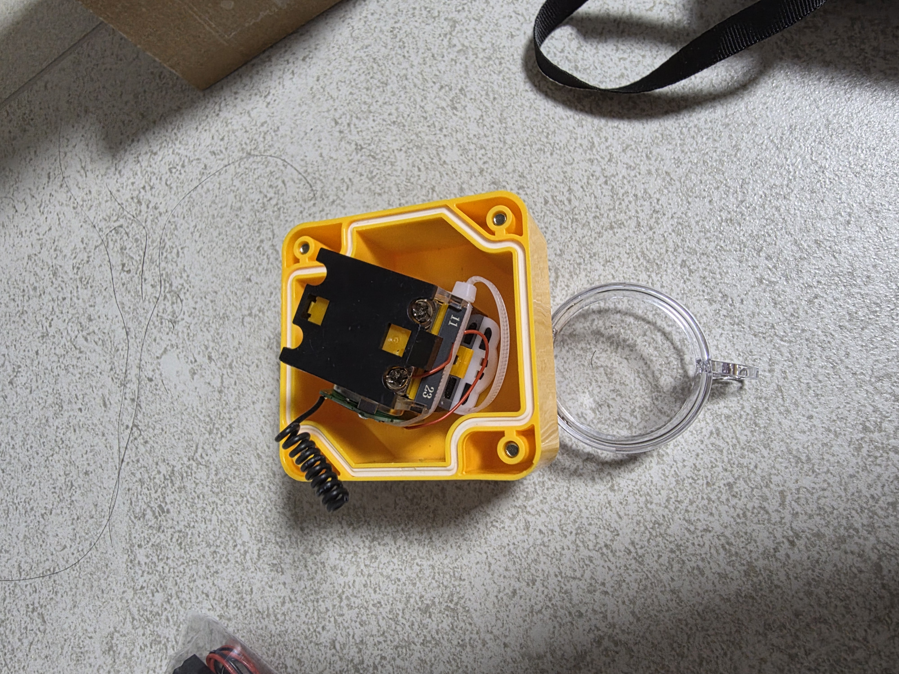
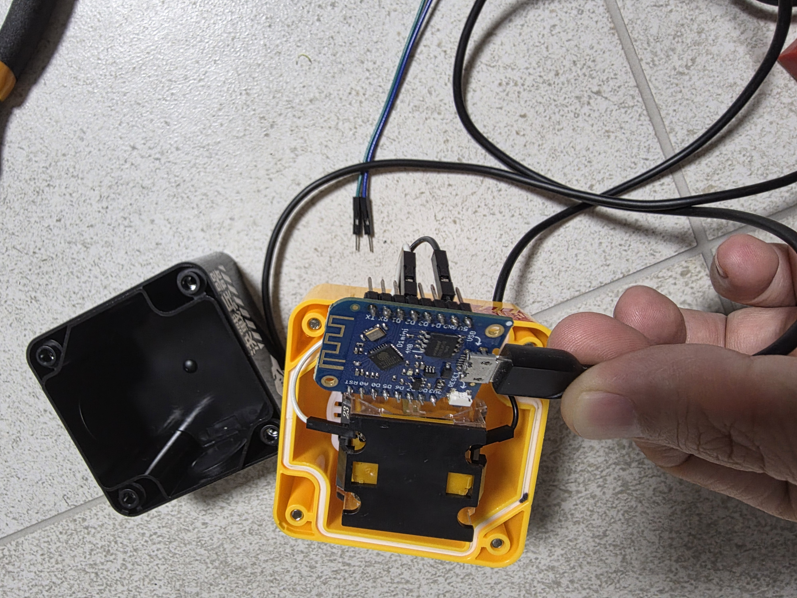
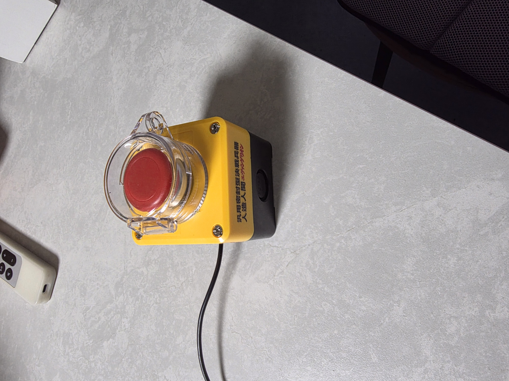

# Neimz Button

A simple button component configuration for ESP8266 (D1 Mini).

## Configuration

Use the [shared device setup](../../README.md#common-device-setup) with
[`neimz_d1_mini.yaml`](neimz_d1_mini.yaml):

```yaml
packages:
  remote:
    url: https://github.com/eigger/espcomponents
    ref: master
    files:
      - packages/device_base.yaml
      - packages/button/neimz/neimz_d1_mini.yaml
```

Set `name`, `friendly_name`, and Wi-Fi/OTA secrets as described in the shared setup.
The package provides the D1 Mini board definition. In Home Assistant, enable the
ESPHome device's permission to perform Home Assistant actions so button events
can reach automations.

## Features

- Detects "Single Click" and "Hold" (Long Press).
- Sends events to Home Assistant (`esphome.esp_button`) to publish the button action (`action: "single"` or `action: "hold"`).
- Built-in LED feedback on D4 when the button is pressed.

## Wiring (ESP8266 D1 Mini)

| Button | ESP8266 (D1 Mini) |
|---|---|
| SIG / PIN | D2 (GPIO4) |
| GND | GND |

*Note: The pin is configured with an internal pull-up (`pullup: true`) and inverted logic (`inverted: true`). This means the button should connect the D2 pin to GND when pressed.*

## Images

| 1 | 2 | 3 |
|---|---|---|
|  |  |  |

## Purchase Link

[AliExpress](https://ko.aliexpress.com/item/1005006076558656.html)

## Home Assistant Automation Example

Here is an example automation that toggles a switch when a "Single Click" event is detected:

```yaml
alias: Button Single Click
description: ""
triggers:
  - trigger: event
    event_type: esphome.esp_button
    event_data:
      action: single
conditions: []
actions:
  - action: switch.toggle
    target:
      entity_id: switch.your_switch  # Replace with your entity
mode: single
```
If several devices emit `esphome.esp_button`, also filter by the device identifier
in the received event data. Inspect an event in Home Assistant before adding that filter.
