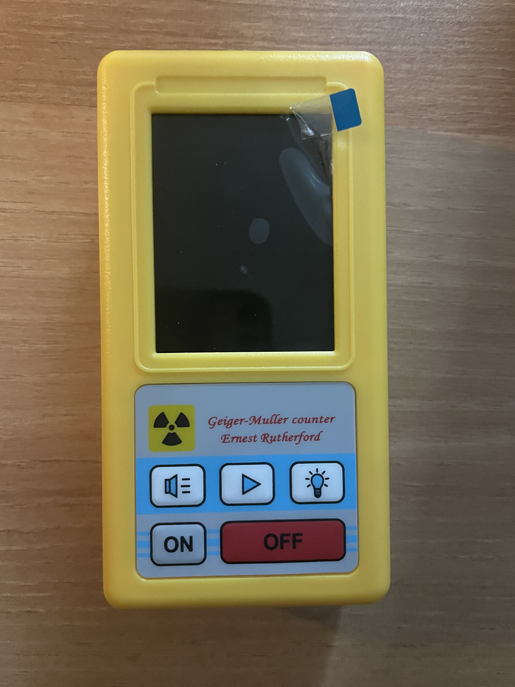
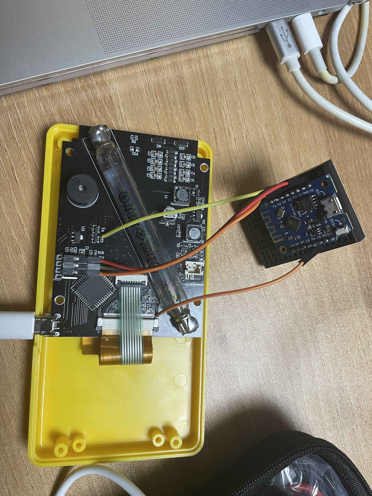
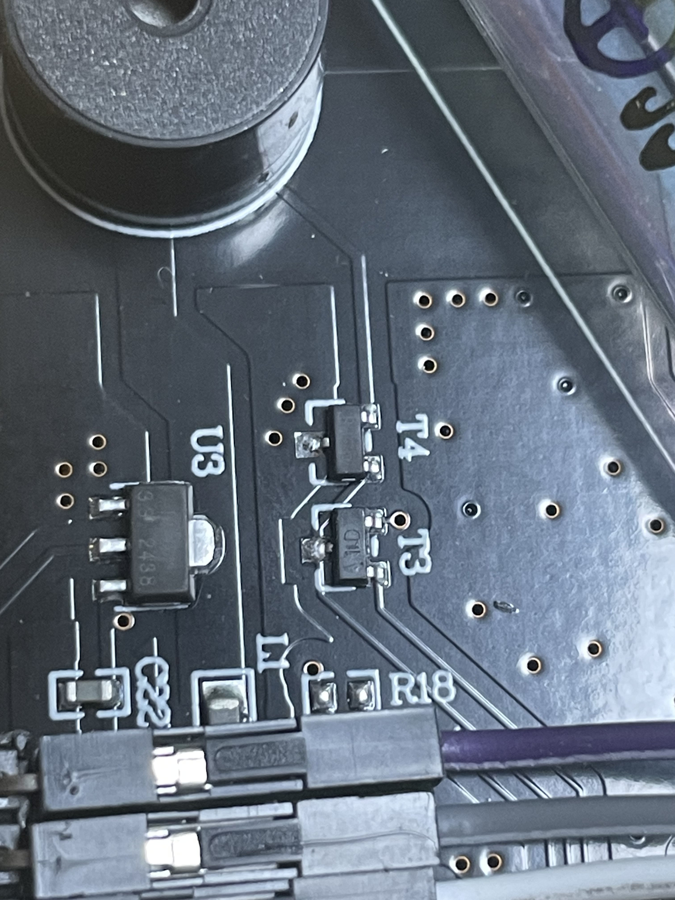
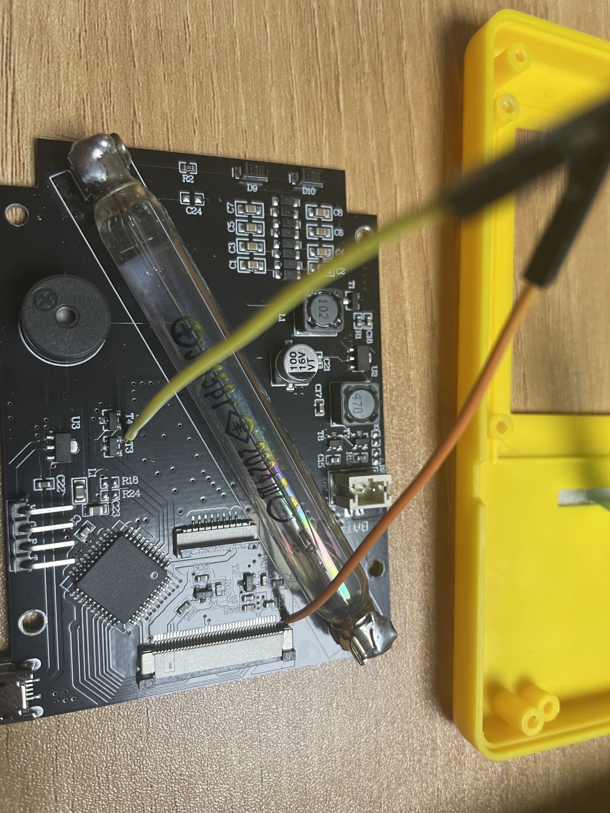
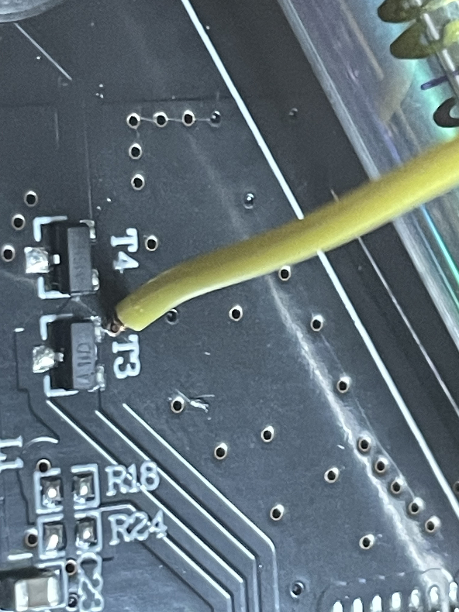
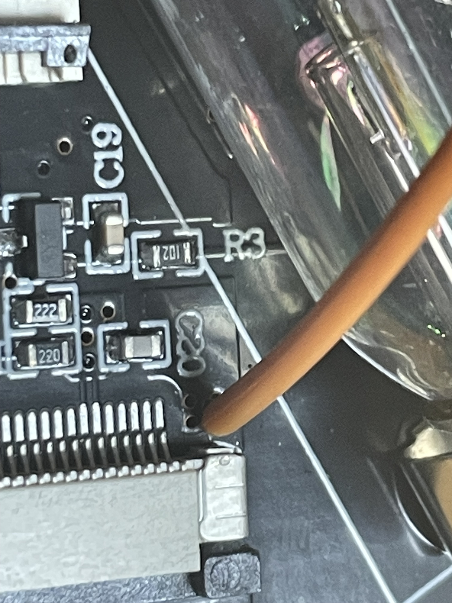
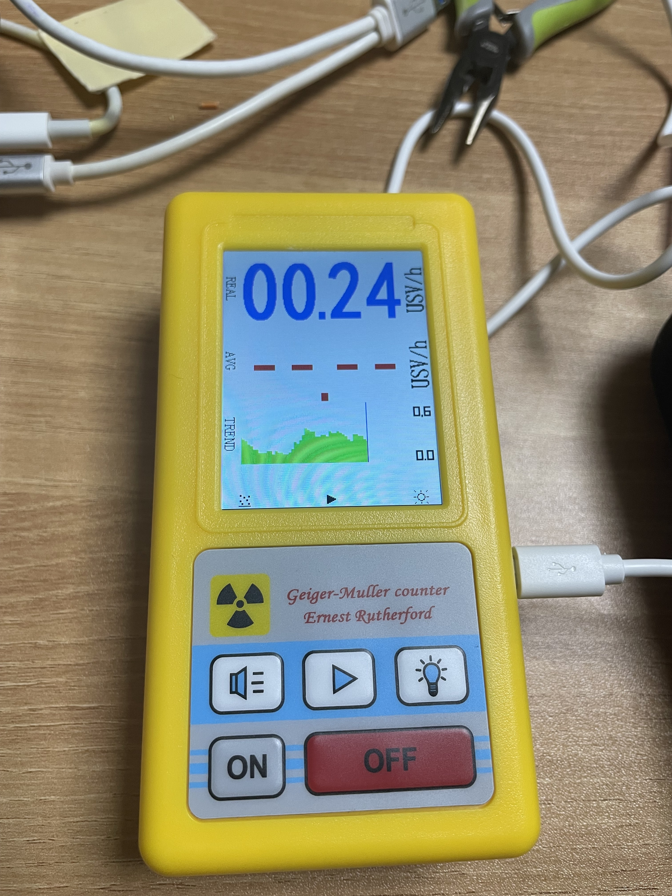
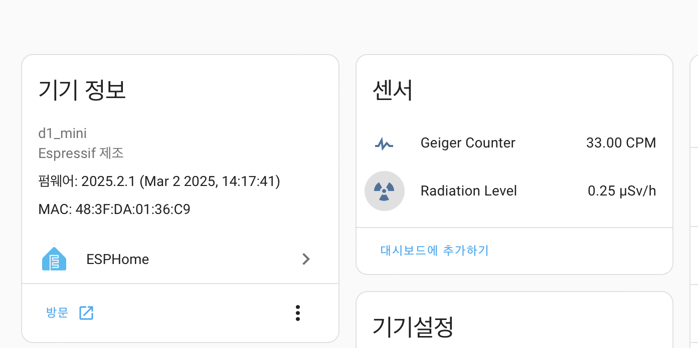

# BR6 Geiger Counter

D1 Mini configuration for pulse counting. Publishes CPM every 20 seconds and an
estimated dose rate using the configured `CPM × 0.0075` conversion factor.

## Configuration

```yaml
packages:
  remote:
    url: https://github.com/eigger/espcomponents
    ref: master
    files:
      - packages/device_base.yaml
      - packages/radiation/br6_d1_mini.yaml
```

Set `name`, `friendly_name`, and Wi-Fi/OTA secrets using the
[shared device setup](../README.md#common-device-setup). The package includes the
ESP8266 board definition. The conversion factor is specific to this configuration;
check it against the detector/tube calibration before interpreting dose-rate values.

## Wiring (ESP8266)

T3 <-> GPIO4 (D2)  
T5 <-> GPIO12 (D6)  

Only **T3 → D2 (GPIO4)** is read by the current pulse-counter YAML. The remaining
connections below document the photographed assembly; no UART or T5 input is
configured in this package.

### Header Pins

V <-> 5V  
G <-> GND  
R <-> GPIO5 (D1)  

## Images

| 1 | 2 | 3 | 4 |
|---|---|---|---|
|  |  |  |  |

| 5 | 6 | 7 | 8 |
|---|---|---|---|
|  |  |  |  |

