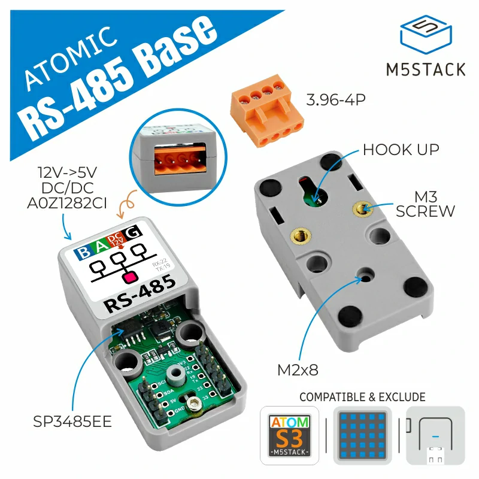
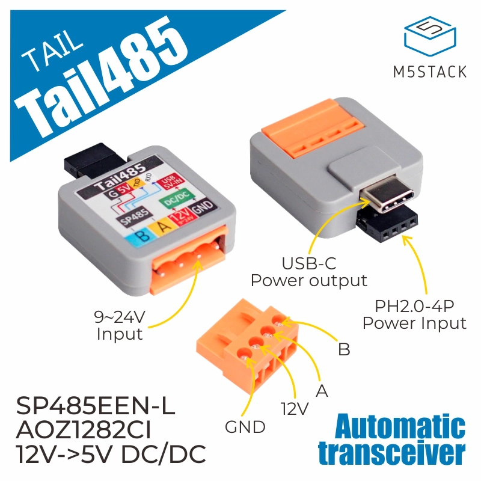
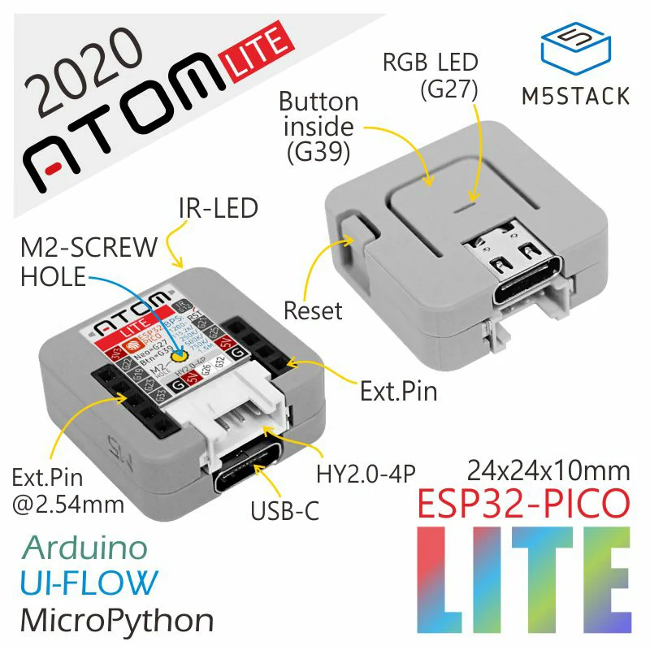
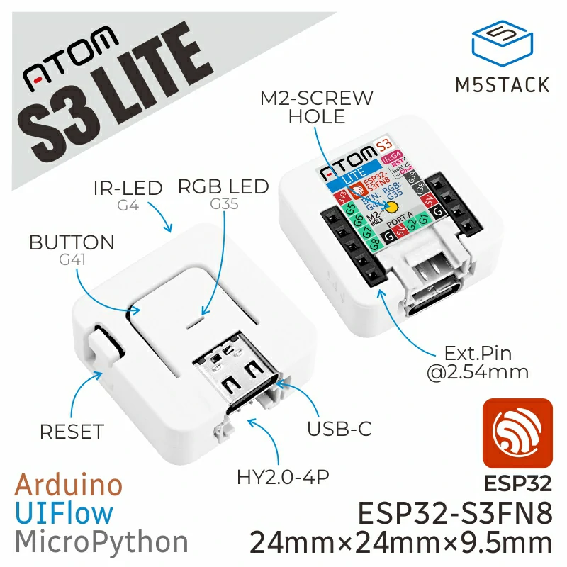
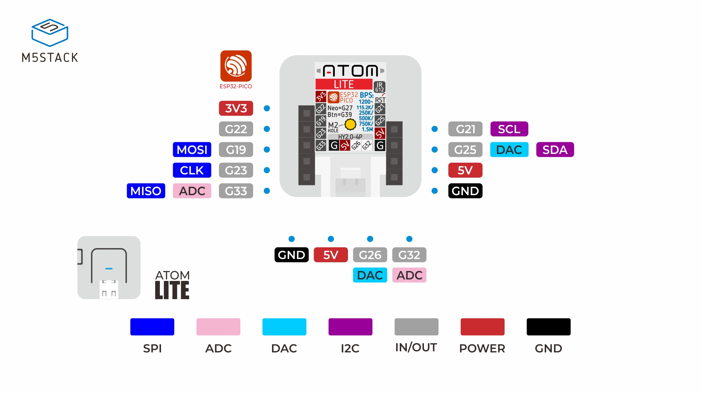
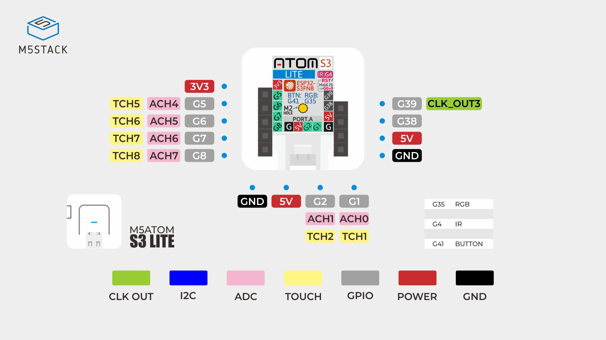

# RS-485 월패드 패키지

제조사별 프로토콜을 [uartex](../../components/uartex)로 Home Assistant에
연결하는 구성입니다. 같은 제조사라도 단지·모델에 따라 패킷과 방 주소가 다를 수
있으므로 해당 패키지의 설정을 먼저 확인하세요.

## 제조사 선택

| 제조사 | 구성 문서 |
| --- | --- |
| 코콤 | [범용 / Theart / Thinks / 현관문](kocom) |
| 현대 | [Imazu / 현관문](hyundai) |
| 삼성 SDS | [월패드 / 현관문](samsung) |
| 코맥스 | [패킷 및 구성 — 실기기 검증 전](commax) |
| CVnet | [작성 중 / 실기기 검증 전](cvnet) |
| 이지빌 | [작성 중 / 실기기 검증 전](ezville) |

## 기본 구성

Atom Lite + Atomic RS485 Base에서 코콤 범용 구성을 사용하는 예입니다.
마지막 파일을 선택한 제조사 패키지로 바꾸세요.

```yaml
substitutions:
  name: my-wallpad
  friendly_name: "Wallpad"

esp32:
  board: m5stack-atom
  framework:
    type: esp-idf

packages:
  remote:
    url: https://github.com/eigger/espcomponents
    ref: master
    files:
      - packages/device_base.yaml
      - packages/wallpad/kocom/kocom.yaml
```

Wi-Fi/OTA secrets는 [공통 설정](../README.md#common-device-setup)을 참고하세요.
월패드와 현관문 프리셋은 각각 UART를 정의하므로, 파일 두 개를 그대로 합치지 말고
버스와 `uartex` ID를 분리한 사용자 구성을 작성하세요.

## 하드웨어와 UART 핀

Atom 보드 1개와 RS-485 변환 모듈 1개를 조합합니다.
아래 표의 RX/TX는 ESP32 측 핀이며, 연결한 조합에 맞게 `uart:`를 덮어쓰세요.

| 보드 | RS-485 모듈 | RX | TX |
| --- | --- | --- | --- |
| Atom Lite | Atomic RS485 Base | GPIO22 | GPIO19 |
| Atom Lite | Tail485 | GPIO32 | GPIO26 |
| AtomS3 Lite | Atomic RS485 Base | GPIO5 | GPIO6 |
| AtomS3 Lite | Tail485 | GPIO1 | GPIO2 |

```yaml
# AtomS3 Lite + Tail485 example
esp32:
  board: m5stack-atoms3
  framework:
    type: esp-idf

uart:
  rx_pin: GPIO1
  tx_pin: GPIO2
```

속도·패리티·프레임 설정은 제조사 YAML에 있으므로 핀 변경 시 함께 확인하세요.
기본 예제의 Atom Lite 설정을 AtomS3 설정과 동시에 선언하지 마세요.

<details>
<summary>제품 사진과 핀맵</summary>








</details>

## 수신·제어가 안 될 때

1. `esphome config my-wallpad.yaml`로 설정을 확인합니다.
2. 장치 YAML에서 `logger.level: DEBUG`로 임시 변경하고 수신 여부를 확인합니다.
3. RX/TX, 속도, 패리티와 프레임 설정을 선택한 제조사 YAML과 비교합니다.
4. 수신 패킷의 방·장치 주소를 확인한 뒤 엔티티별 패킷을 수정합니다.

[패키지 목록](../README.md) · [월패드 연동 가이드](https://github.com/eigger/espcomponents/wiki)
