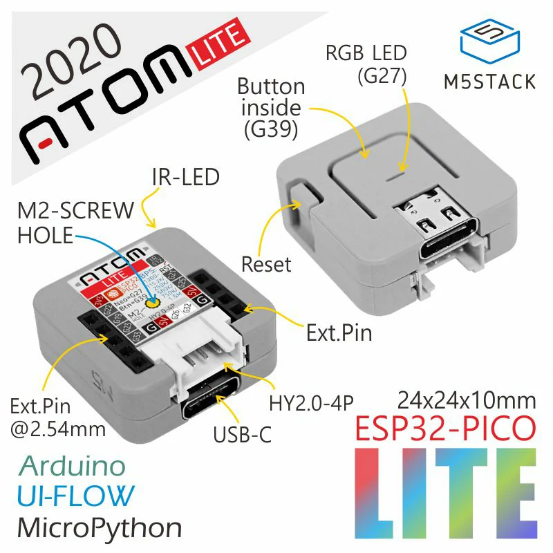
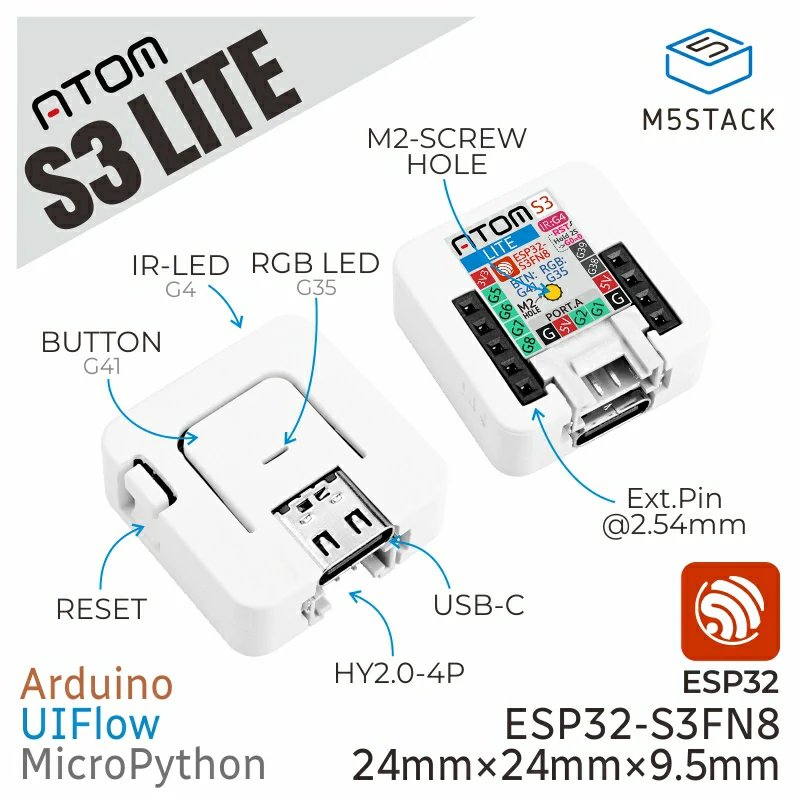
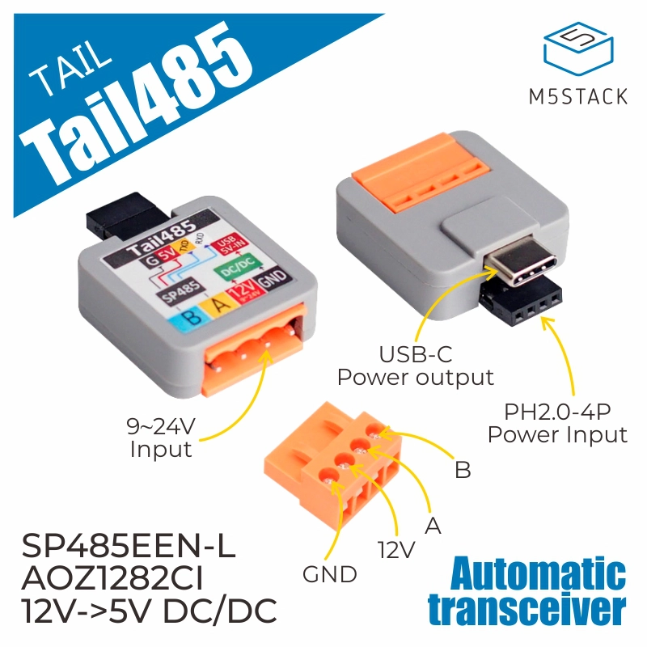
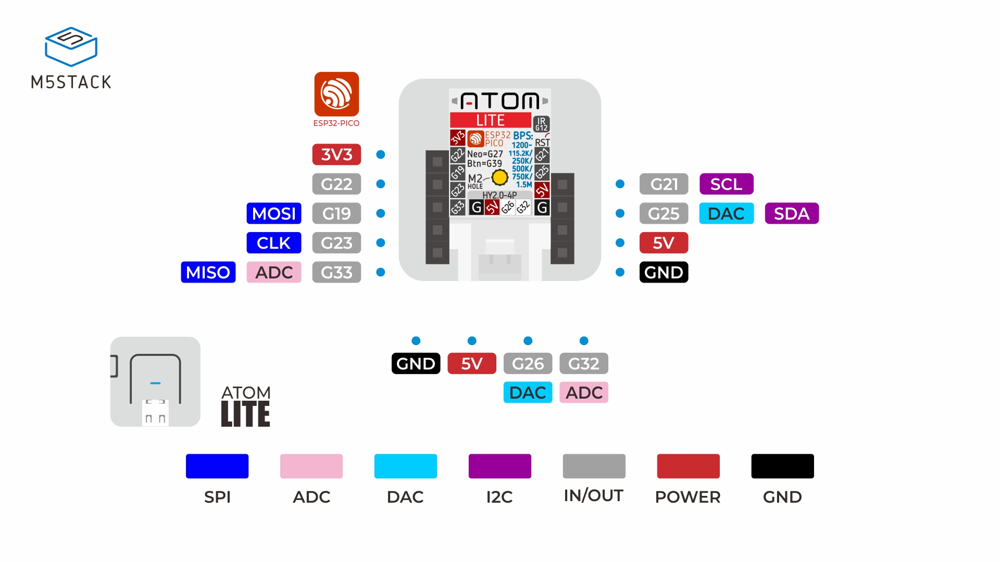
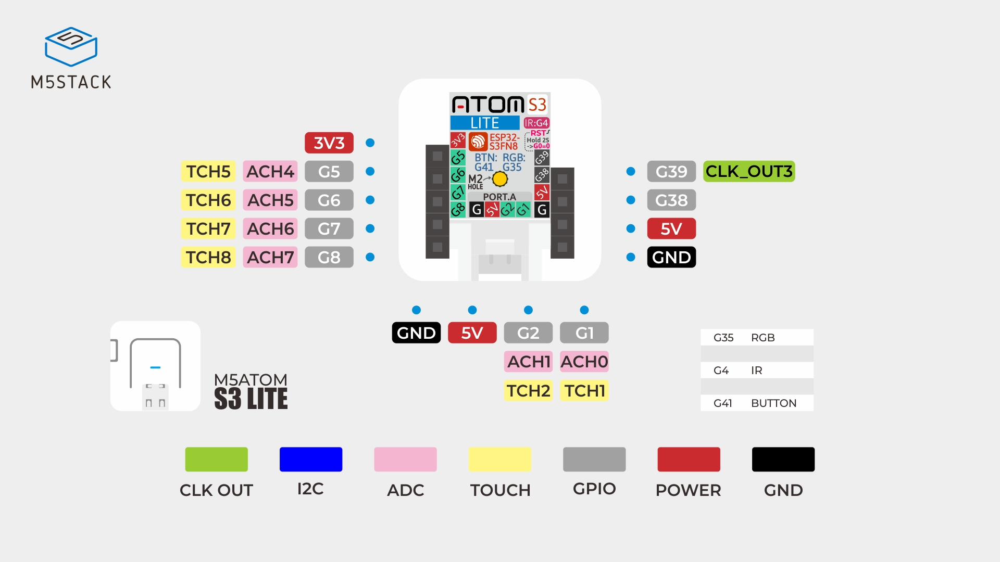

# RS-485 월패드 패키지

제조사별 월패드 프로토콜을 [uartex](../../components/uartex)로 Home Assistant에 연결하는 구성입니다.

> [!TIP]
> **처음이라면** 위키의 [월패드 시작하기](https://github.com/eigger/espcomponents/wiki/ESPHome-%EC%9B%94%ED%8C%A8%EB%93%9C-%EC%8B%9C%EC%9E%91%ED%95%98%EA%B8%B0)를 따라 하세요. 준비물부터 Home Assistant 연동까지 스크린샷과 함께 안내합니다.
> 보드·모듈 교체, 다른 월패드 적용, YAML 수정은 [월패드 응용하기](https://github.com/eigger/espcomponents/wiki/ESPHome-%EC%9B%94%ED%8C%A8%EB%93%9C-%EC%9D%91%EC%9A%A9%ED%95%98%EA%B8%B0)를 참고하세요.

## 제조사 선택

| 제조사 | 파일 |
| --- | --- |
| [코콤](kocom) | 범용 · Thinks · Theart · 현관문 |
| [현대](hyundai) | Imazu · 현관문 |
| [삼성 SDS](samsung) | 월패드 · 현관문 |
| [코맥스](commax) | 월패드 |
| [CVnet](cvnet) | 월패드 |
| [이지빌](ezville) | 월패드 |

같은 제조사라도 단지·모델에 따라 패킷과 방 주소가 다를 수 있으므로, 설치 후 수신 로그와 YAML을 비교해 확인하세요.

## 기본 구성

Atom Lite + Atomic RS485 Base에서 코콤 범용 구성을 사용하는 예입니다.
`files:`의 마지막 줄을 사용할 제조사 파일로 바꾸고, 다른 보드·모듈이라면 아래 [하드웨어와 UART 핀](#하드웨어와-uart-핀)에 따라 `uart:`를 추가하세요.

```yaml
substitutions:
  name: "esp-kocom"
  friendly_name: "ESP Kocom"

esp32:
  board: m5stack-atom
  framework:
    type: esp-idf

packages:
  remote:
    url: https://github.com/eigger/espcomponents
    ref: latest
    files:
      - packages/device_base.yaml
      - packages/wallpad/kocom/kocom.yaml
```

- Wi-Fi·OTA secrets는 [공통 설정](../README.md#common-device-setup)을 참고하세요.
- 단독 현관문 패키지는 별도 장치에 설치하세요. 삼성 SDS 월패드와 가상 인터폰을 같은 회선에서 쓰려면 공용 회선 패키지 하나를 포함하세요. [삼성 SDS 구성](samsung/README.md#월패드와-가상-인터폰을-같은-회선에서-사용하기)

## 하드웨어와 UART 핀

Atom 보드 1개와 RS-485 모듈 1개를 조합합니다. 제조사 YAML의 기본 핀은 **Atom Lite + Atomic RS485 Base**이며, 다른 조합은 YAML 맨 아래에 `uart:` 핀을 추가해 덮어씁니다.

| 보드 | RS-485 모듈 | `board:` | RX | TX |
| --- | --- | --- | --- | --- |
| Atom Lite | Atomic RS485 Base | `m5stack-atom` | GPIO22 | GPIO19 (기본값) |
| Atom Lite | Tail485 | `m5stack-atom` | GPIO32 | GPIO26 |
| AtomS3 Lite | Atomic RS485 Base | `m5stack-atoms3` | GPIO5 | GPIO6 |
| AtomS3 Lite | Tail485 | `m5stack-atoms3` | GPIO1 | GPIO2 |

```yaml
# 예: AtomS3 Lite + Tail485
esp32:
  board: m5stack-atoms3
  framework:
    type: esp-idf

uart:
  rx_pin: GPIO1
  tx_pin: GPIO2
```

속도·패리티·프레임 설정은 제조사 YAML에 들어 있으므로 `uart:`에는 핀만 적으면 됩니다.

<details>
<summary>제품 사진과 핀맵</summary>








</details>

## 수신·제어가 안 될 때

1. `esphome config`(또는 Device Builder의 Save)로 설정 오류가 없는지 확인합니다.
2. 장치 YAML에 `logger:` → `level: DEBUG`를 임시로 추가하고 패킷이 들어오는지 확인합니다.
3. 보드·모듈 조합에 맞는 `uart:` 핀을 넣었는지, RS-485 A/B 결선이 바뀌지 않았는지 확인합니다.
4. 수신 패킷의 방·장치 주소를 확인한 뒤 엔티티별 패킷을 수정합니다. 패킷을 모으려면 Home Assistant의 **기록 → 데이터 다운로드**에서 UARTEx 로그를 CSV로 저장합니다. 자세한 순서는 [월패드 패킷 로그](https://github.com/eigger/espcomponents/wiki/ESPHome-%EC%9B%94%ED%8C%A8%EB%93%9C-%ED%8C%A8%ED%82%B7-%EB%A1%9C%EA%B7%B8)를 참고하세요.

## 제보하기

구성이 **잘 동작했거나**, 새 단지·장치 **구성을 추가했거나**, **오류가 발생했다면** 제보해 주세요. 같은 월패드를 쓰는 다른 분들께 큰 도움이 됩니다.

- [이슈 등록](https://github.com/eigger/espcomponents/issues/new) — 동작 확인, 오류, 구성 추가 (Pull Request도 환영합니다)
- [질문·토론](https://github.com/eigger/espcomponents/discussions/new?category=q-a)

제보할 때 **제조사·단지(모델)**, **사용한 파일**, 가능하면 **수신 로그**를 함께 적어 주시면 확인이 빠릅니다.

[패키지 목록](../README.md) · [위키: 월패드 시작하기](https://github.com/eigger/espcomponents/wiki/ESPHome-%EC%9B%94%ED%8C%A8%EB%93%9C-%EC%8B%9C%EC%9E%91%ED%95%98%EA%B8%B0)
